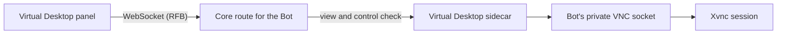

The **Virtual Desktop** panel shows a whole remote Linux desktop inside Ryu. You can watch it and
use your mouse and keyboard. On a managed cloud computer, each Bot can have its own screen.

## What you get

- **A whole Linux desktop.** The node runs a headless X session (TigerVNC Xvnc, a window manager,
  and starter apps) with a private VNC Unix socket. The panel connects a VNC client (noVNC) to it
  over Core's WebSocket tunnel.
- **Two-way control.** The screen streams down the same socket that carries your mouse and keyboard
  input up.
- **One cloud computer, separate Bot screens.** Files, installed applications, and the cloud
  computer itself are shared. Virtual Desktop screens and Browser app tab lanes are separate per Bot,
  so work running at the same time does not collide.
- **No new firewall rule.** The stream uses Core's existing authenticated port through a generic
  WebSocket tunnel. No sidecar port is exposed, and nothing on the node is reachable without the node
  token.

<Callout type="warn">
  Per-Bot screens separate work, not tenants. They are not an operating-system security boundary.
  Do not place mutually untrusted tenants on one shared node.
</Callout>

<Callout type="warn">
  The virtual desktop is **Linux only**. It needs TigerVNC `Xvnc`, `xauth`, and `openbox` on the
  node. On macOS or Windows the sidecar reports itself unavailable and the panel explains why.
</Callout>

## Enable it

1. **Install the [Virtual Desktop app](/docs/apps/desktop)** (`@ryu/desktop`) for the node. In
   the desktop, open the Store and enable **Virtual Desktop**. The app is opt-in, like Simulators and the Browser
   sidecar.
2. **Make sure the Linux toolchain is on the node.**
   - **Managed (Ryu Cloud) computers:** check **Install the managed computer** when you create the
     cloud computer. This installs the Linux desktop stack and per-Bot screens.
   - **Self-hosted nodes:** follow the self-hosted installation guide and enable the virtual
     desktop option for the node.
   - **Local Linux:** the panel's enable prompt installs the packages for you.
3. Open the **Virtual Desktop** dock panel from the right side of the workspace. It connects and
   shows the node's desktop.

<Callout type="warn">
  A cloud desktop works only after the node finishes provisioning and installs its Linux toolchain.
  If the panel shows "no display", check that **Install the managed computer** was checked when the
  node was created.
</Callout>

## Use it

- **Mouse** clicks and drags map to the virtual screen. **Keyboard** input types into the focused
  app on the desktop.
- The status dot in the panel header shows whether the stream is live. **Reconnect** connects again,
  for example after you switch nodes.
- On a managed cloud computer, choose a **Bot** in the panel header. Switching Bots reconnects to
  that Bot's screen.
- Self-hosted and local Linux nodes without managed Bot screens show a single screen.

### Keep the desktop visible

While the stream is live, Ryu mirrors its latest frames into the shared live-media card.
**Open PiP** opens an always-on-top window, so the remote desktop stays visible while you work
elsewhere. **Expand** opens it full screen. The card always follows the active node, so an old node
does not stay on screen after you switch.

## Session Box screens

The Virtual Desktop panel shows your **node's** desktop. A conversation can also have a screen of
its own. When Ryu Boxes are on for your account, the first computer or browser action in a
conversation starts a **session Box** with its own virtual desktop and browser, and that
conversation's computer use and browser tool run there instead of on the node.

| | Node desktop (this panel) | Session Box screen |
| --- | --- | --- |
| Where it runs | On your node | On a Ryu Box, outside your node |
| Who uses it | The main agent and you | One conversation (and each of its worker threads gets its own) |
| Open it from | The **Virtual Desktop** dock panel | **View screen** in the composer (or the cloud task panel), or the **Box screen** tab |
| Cost | Part of your node | Billed from credits as **Box session compute**, per minute with a 5-minute minimum each time it starts; a resume within the hour already paid owes no new minimum |

### Allow the cost

Computer use goes to a session Box by default. The first time this would start a Box for you, Ryu
asks first. The composer shows a notice with:

- The Box's size.
- Its hourly rate, for example $0.025 an hour for a small Box.
- The 5-minute minimum each time a Box starts.

Nothing starts until you choose **Allow**. If you allow it while the agent is waiting, the Box
starts and the agent carries on. If the agent already gave up, ask it to continue.

Ryu asks once per account. If the rate changed since the notice appeared, Ryu shows the new rate
and asks again. The web chat shows the same notice.

Routines and other runs nobody is watching cannot answer the notice. To let them use a Box, allow
the cost ahead of time: open **Gateway settings → Device settings** for the node, where
**Session Box cost** shows the same notice under **Computer use in conversations**.

### Parking and running on this node

A session Box parks itself after about ten minutes with no activity and nobody watching its
screen. The next action resumes it with its files intact.

To keep a conversation's computer use on this node instead, open **Gateway settings → Device
settings** for the node and set **Computer use in conversations** to **This device**.

<Callout type="warn">
  On an organization's node, scheduled runs, automation runs, and other runs that do not come from
  your own chat message cannot start a Box while session Boxes are on. Their computer and browser
  actions are refused instead of running on the node's desktop. Run that work from a conversation,
  or choose **This device**.
</Callout>

### Watch the cost

While a conversation's session Box runs, the composer shows **Session Box** with its cost so far and
running time (it reads **starting** until the first charge is recorded), and a **View screen**
button. A low-credit warning appears there before the credits run out. If the Box stops because
they did, a banner says so and offers **Top up**. Its files are kept, and it can resume once you
have credits again.

See [Cloud environments](/docs/surfaces/desktop/user-guide/cloud-environments#watch-the-boxs-screen)
for the Box screen controls and its cost display.

## How it works

1. The Virtual Desktop sidecar keeps a display for each managed Bot and starts each Linux graphical
   session when it is first needed.
2. The panel uses an authenticated Core route bound to the selected Bot. Core checks the Bot's view
   and control permission before the request reaches the sidecar.
3. The sidecar bridges the panel's RFB-over-WebSocket stream to that Bot's private VNC socket.

The [Ghost plugin](/docs/plugins/ghost)'s node-wide `computer.control` target is separate from
these Bot screens, so a Ghost action may not appear on the selected screen. Browser app tools
receive the verified calling Bot's identity and keep separate tab lanes per Bot.

### Display authentication

The Linux installer includes TigerVNC Xvnc and `xauth`. The older Xvfb and x11vnc fallback is not
available, so install TigerVNC to view the desktop.

- Each session uses a private service-user Unix socket for RFB instead of a loopback TCP listener.
- Its Xauthority cookie lives in a private session directory, so the service user's own
  Xauthority file is not changed.
- The sidecar removes the session's socket and authority file after its processes stop, including
  when startup fails.

Isolation between processes running as the same operating-system user is outside this boundary.

If the display server or window manager exits, the session becomes unavailable. Reconnecting the
panel starts one replacement session on the same Bot display, with fresh display authentication.
Closing an ordinary starter application leaves the desktop running.

## Platform boundary

Managed cloud screens are Linux virtual desktops. A native macOS or Windows node cannot provide the
same unattended background screen while keeping the user's own desktop private, so the sidecar
reports per-Bot screens unavailable there. Docker Desktop on those hosts can run a Linux desktop
inside its VM, but that is a separate Linux guest, not a native macOS or Windows desktop.

## Related

<Cards>
  <DocCard href="/docs/apps/desktop" />
  <DocCard href="/docs/surfaces/desktop/user-guide/tools-and-connections" />
  <DocCard href="/docs/plugins/ghost" />
  <DocCard href="/docs/core/sandbox" />
  <DocCard href="/docs/core/swappable-layers" />
</Cards>
