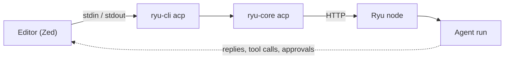

ACP (Agent Client Protocol) is a protocol that lets a code editor talk to an AI agent over the
agent's standard input and output. `ryu-cli acp` makes Ryu an ACP agent. The editor starts the command,
and your messages go to the Ryu node that is already running on your machine. Replies, reasoning,
tool calls, and tool approvals stream back into the editor's agent panel.



This is the reverse of [ACP agent integration](/docs/extend/integrate/acp-integration), where Ryu
is the client that drives agents such as Claude Code or Codex.

To keep using your own coding agent (Claude Code, Codex, Cursor, opencode, or Gemini CLI) and give
it Ryu's tools instead, run `ryu-cli connect <agent>`. That adds Ryu as an MCP server in the agent's
config. See [Coding agents](/docs/surfaces/cli/reference#coding-agents).

## Before you start

- Ryu must be running. Open the desktop app, or run `ryu-cli` in a terminal once. `ryu-cli acp`
  does not start Ryu for you.
- `ryu-cli` must be on the editor's `PATH`. The installers put it in `~/.ryu/bin`; if your editor
  does not inherit your shell's `PATH`, use the absolute path (for example `~/.ryu/bin/ryu-cli`) as
  the command. See [CLI getting started](/docs/surfaces/cli/getting-started).
- Run the editor as the same user account as Ryu. `ryu-cli acp` uses the same local node
  credentials as the other `ryu-cli` commands.

## Set up Zed

<Steps>
<Step>Open Zed's settings file. Run `zed: open settings` from the command palette.</Step>
<Step>

Add Ryu to the `agent_servers` object as shown:

```json
{
  "agent_servers": {
    "Ryu": {
      "type": "custom",
      "command": "ryu-cli",
      "args": ["acp"],
      "env": {}
    }
  }
}
```

</Step>
<Step>Open the Agent Panel, choose **New Thread**, and pick **Ryu**.</Step>
</Steps>

To start every thread with one Ryu agent, add `--agent` to `args`, for example
`["acp", "--agent", "coder"]`. Other ACP editors take the same command and arguments in their own
agent server settings.

## Command flags

| Flag | Meaning |
|---|---|
| `--agent <id>` | The Ryu agent new threads start with. Without it, the node's default agent is used. An unknown id fails with the list of available agents. |
| `--node <name\|url>` | Connect to a saved node (by name) or another node URL instead of the local one. `RYU_CORE_URL` or a remote active node (`ryu-cli node use`) does the same. |
| `-h`, `--help` | Show help. |

`ryu-cli acp` starts `ryu-core acp`, which does the protocol work. You can also give the editor
`ryu-core` with the same `["acp"]` arguments directly. `ryu-core acp` accepts `--agent` and takes
`--core-url <url>` in place of `--node`.

## Choose an agent in the editor

Ryu shows each of your agents as a session **mode**. Use the editor's mode picker to switch the
agent for the next message in the same thread. Each thread is saved as a normal Ryu conversation,
so it also appears in the desktop app.

## What works

| Capability | Behavior |
|---|---|
| Text prompts | Sent to the chosen agent as the next turn of the conversation. |
| Images | Sent as image attachments. |
| Files and selections the editor attaches | Sent as text documents. |
| Replies and reasoning | Stream into the panel as they arrive. |
| Tool calls | Show as tool rows with their arguments, status, and output. |
| Tool approvals | When Ryu asks before running a tool, the editor shows the prompt. If you reject it, close it, or it fails, Ryu denies the tool. |
| Questions with choices | When Ryu pauses the agent to ask you to pick from a list, the editor shows the choices as a prompt with a Skip option. If the agent stopped waiting before your choice arrived, the reply says so; send your answer as a message instead. |
| Questions that need typed answers | The question appears in the reply and is skipped, so the agent continues instead of waiting. A question tool the agent answers on its own shows as an ordinary tool row. |
| Stop | Stopping a reply ends the turn and asks Ryu to stop the run. |
| Reopen a thread | The editor can reload an earlier Ryu conversation and continue it. |

<Callout type="warn">
Tools run inside Ryu, under Ryu's own permissions and policies. Ryu does not use the editor's file
or terminal access, and it ignores MCP servers the editor offers. Configure MCP servers in Ryu
instead. Audio prompts are not supported. Ryu reports each finished turn as a normal end of turn;
it does not report token-limit or refusal stops separately.
</Callout>

## Troubleshooting

| Message in the editor | Fix |
|---|---|
| `Ryu is not running or not reachable at …` | Start Ryu, then start a new thread. |
| `Ryu rejected this connection's credentials` | Run the editor as the same user as Ryu. For a remote node, give `ryu-cli` that node's credentials as you would for any other `ryu-cli` command. |
| `Ryu refused this request (HTTP 403): …` | The credential works, but your role or your organization's policy does not allow the request. The text after the colon names the missing permission or the policy. Ask your administrator. |
| `Ryu has no agent '…'` | Fix the `--agent` value. The message lists the agents that exist. |

`ryu-cli acp` writes its logs to standard error. Standard output carries only protocol messages.

## See also

<Cards>
  <DocCard href="/docs/surfaces/cli" />
  <DocCard href="/docs/extend/integrate/acp-integration" />
  <DocCard href="/docs/core/conversations-sessions" />
</Cards>
