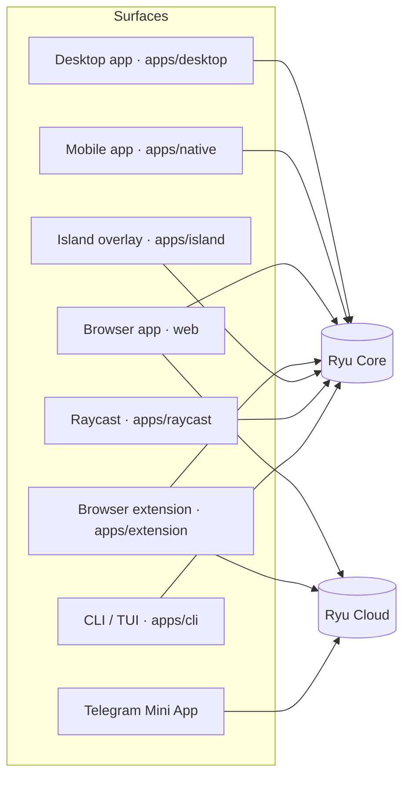

A surface is a client you use Ryu through. Every surface connects to the same Core server, which
can be a Ryu Cloud managed node or a self-hosted node. When clients connect to the same server, a
chat keeps its conversation and context as you move between them.

<Figure name="surfaces" />

In the desktop app, **Bot** is the managed consumer mode, **OS** is the agent-first desktop
workspace, and **Agent** is the power-user and admin mode. On the web, **Console** manages your
account and organizations.

## Choose a surface

<Cards>
  <DocCard href="/docs/surfaces/desktop" />
  <DocCard href="/docs/surfaces/island" />
  <DocCard href="/docs/surfaces/raycast" />
  <DocCard href="/docs/surfaces/webapp" />
  <DocCard href="/docs/surfaces/public-website" />
  <DocCard href="/docs/surfaces/public-profiles" />
  <DocCard href="/docs/surfaces/telegram-mini-app" />
  <DocCard href="/docs/browser-extension" />
  <DocCard href="/docs/mobile" />
  <DocCard href="/docs/surfaces/editors" />
  <DocCard href="/docs/surfaces/cli" />
</Cards>

<Callout type="warn">
Island is not available in the current desktop release. Its page describes the companion as it will
work once it ships.
</Callout>

## What each surface adds

| Surface | What belongs to this surface |
|---|---|
| OS / desktop workspace | Dock, live App windows, App Launcher, and desktop wallpaper controls |
| Agent / desktop app | Native windows, local engines and sidecars, and media picture-in-picture (PiP) |
| Mobile app | Server-scoped waitlist for signed-in node access, plus `llama.rn` on-device models, notifications, Live Activities, haptics, and device tools |
| Browser app | The shared Desktop shell in a browser, account sign-in through the waitlist, a choice of local Core or Ryu Cloud, and browser navigation |
| Telegram Mini App | The browser app inside Telegram, signed in with a linked Telegram account, with Telegram Back navigation, theme, and viewport |
| Browser extension | Server-scoped waitlist for signed-in node access, plus browser-local Transformers.js inference, in-page copilot, and browser tools |
| Island | Global overlay, command bar, context suggestions, voice input, and dictation (not in the current release) |
| Raycast | One-shot questions, multi-turn chat, and conversation search from Raycast |
| CLI / TUI | Server-scoped waitlist for signed-in node access, HTTP/SSE chat, keyboard navigation, and terminal list and table renderers |
| Editors (ACP) | Ryu agents inside an Agent Client Protocol editor such as Zed, through `ryu-cli acp` |

Shared Core APIs, conversations, agents, permissions, and provider routing are portable between
surfaces. Native effects are not. A client feature-detects them through
[native bridges](/docs/extend/develop/extensions/native-bridges).

The Desktop shell is the composition contract that the Web app, Mobile app, and Browser extension
inherit. See [plugins vs apps](/docs/extend/develop/extensions/plugins-vs-apps) for what a package
inherits.

## See also

<Cards>
  <DocCard href="/docs/start-here/architecture/core-vs-gateway" />
  <DocCard href="/docs/core/node-and-presence" />
  <DocCard href="/docs/core/conversations-sessions" />
  <DocCard href="/docs/extend/develop/extensions/native-bridges" />
</Cards>
