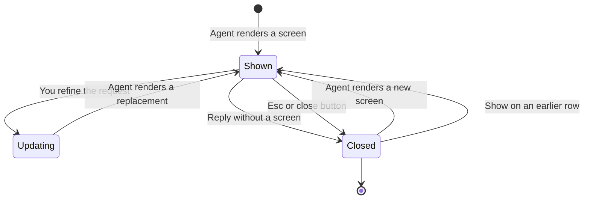
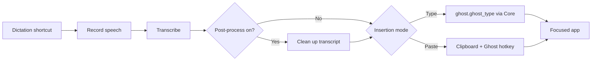

The **Island** (`apps/island`) is an Electron overlay that sits beside the desktop app on the same
machine, shaped like a small pill at a screen edge. It talks to the same Core as the desktop app, so
it shares your conversations, agents, and Gateway routing. Switching from the app to the Island
keeps your context.

<Callout type="warn">
  Island is not available in the current desktop release. The installer may download and update the
  Island bundle in the background, but the desktop app does not launch it and does not show its
  controls (service status, tray toggle, onboarding install, global shortcuts, or settings).

  Island is also hidden from the Store until it ships. This page describes the companion as it will
  work once it ships.
</Callout>

Island is an **optional Desktop app**. Once it ships, you install it from the Store; it is not
installed automatically. After installation, its node-scoped settings are under
**Gateway settings → Apps → Island** for the node that runs the companion. Use the app's Enabled
control in Gateway settings to turn the companion on or off.

## What it does

- A global shortcut expands the resting pill into a **command bar and mini chat** connected to Core.
  Stopping a chat reply in the Island also stops it in Core.
- **Shadow** context monitoring and a **local-model proactive engine** surface suggestion chips
  based on what is on your screen, once you allow it.
- **Push-to-talk voice input** sends speech to the Island chat, and
  [system-wide dictation](/docs/surfaces/island#system-wide-dictation) types speech into the focused app.
- **Generated screens** show an agent's interactive answer in a floating window.

Screen context and proactive suggestions start off; see the privacy settings below.

## Island settings

Install and enable Island, then open **Gateway settings → Apps → Island**. The settings apply to the
active node that runs the companion and save as you change them. If a preference save fails, Island
restores the previous value and shows an error so you can retry.

### Privacy and capture

- Chat is on by default. Screen context and Proactive suggestions start off, and Proactive
  suggestions require Screen context.
- **Hide from screen capture** keeps the Island out of screenshots, recordings, and screen sharing
  while it stays visible to you.
- **Hide on fullscreen apps** is available on Windows only.
- The Shadow capture mirrors let you toggle frame recording and pause all capture. Revoking screen
  context hides capture details right away.

### Agents and voice

- Choose separate agents for chat and proactive suggestions, or choose **Default local model**.
- Push-to-talk has its own enable switch, shortcut, and toggle or hold-to-talk mode. While it is on,
  the **Activation** row explains how the chosen mode starts and stops recording. Pressing Tab while
  recording switches which agent handles the task.
- You can choose the voice recognition engine.
- Read-back speaks assistant replies aloud. It is on by default, uses Kokoro 82M, and pauses while a
  meeting is recording. Choose its audio engine and voice when it is enabled.

### Appearance and position

- **Background.** Choose Native glass, Mica, or Translucent. See
  [Background materials](/docs/surfaces/island#background-materials) for what each one does.
- **Edge offset.** Applies to each docked edge and to both axes at corners. The default is 0 px on
  macOS and 20 px on other desktop platforms.
- **Auto-jump to active monitor.** Follows the monitor under your cursor only while the Island is at
  rest. It does not jump while you drag it, while its panel is open, or while a wider pill (an app
  label, a recording, or a suggestion) is pulled in from a screen edge. It has no effect on a
  single-monitor setup.

Drag the companion near a corner, edge, or the center to dock it there, or drop it anywhere else to
leave it in place. It opens away from the nearest screen edges: from the bottom-right it opens up
and to the left, and from the top center it opens downward.

When it collapses, it returns to the same spot. If you move the open panel, the companion collapses
where you dropped it.

### Notch mode

Notch mode attaches the companion to the camera notch on a supported Mac. It is off by default, and
turning it on updates the running companion immediately.

- It uses a black surface with rounded lower corners and keeps interactive content below the
  camera. Click the Ryu eyes or use the command shortcut to expand it.
- While attached, the companion stays on the notched display. Dragging, edge offset, and auto-jump
  do not move it away from the notch.
- Background and floating placement preferences remain available when you turn it off.
- If no connected display has a detected camera notch, or on other operating systems, the companion
  uses floating mode.

### Shortcuts

Click a shortcut, press a key combination, or press Escape to cancel. Use **Reset** to restore the
default command-bar or push-to-talk shortcut.

## Shortcut priority

The command-bar, push-to-talk, and dictation shortcuts take priority over plugin
shortcuts. If you set one of them to a key combination an app uses, the Island
feature takes that combination and the app's shortcut stops responding; a
combination the Island stops using goes straight back to the app that declared it.

The Island checks your enabled apps about every ten seconds, so the shortcut of an app you enable or
disable starts or stops working within that time without a restart. If your saved shortcut
settings cannot be read, the Island keeps the plugin shortcuts it already has rather than restoring
app defaults, and retries on its own.

## Appearance sync

The Island reads the Desktop's shared appearance preference through Core. Its hosted app and plugin
surfaces receive the same settings as the Desktop Companion surface: light/dark palette, custom
theme colors, contrast, radius, spacing, zoom, font stacks, cursor, overlay, motion, display
timezone, and locale.

Theme and Date & time changes update an already-open surface without remounting it. Switching the
Island's window material recreates only its native window, because the compositor material is
chosen at construction time.

### Background materials

The Island's **Background** setting controls its transparent window independently of the Desktop
window surfaces. Changing it applies right away: the running Island rebuilds its window in the new
style, with no restart.

| Background | Behavior |
|---|---|
| **Native glass** (default) | macOS 26 and later use native Liquid Glass; older macOS uses Sidebar vibrancy. Windows 11 22H2 and later use system Acrylic; older Windows uses native Acrylic when its companion module is available. The logo, detail panel, and suggestion actions keep their clear gaps |
| **Mica** | Windows 11 Mica when available, Acrylic elsewhere |
| **Translucent** | Separate floating shapes with a soft shadow and a CSS backdrop blur, inside a larger transparent window. No native OS material on any platform, so the blur reaches only the Island's own contents and apps behind it stay sharp |

With **Translucent**, the window around the shapes passes clicks through to the apps beneath it at
rest. While the panel or command bar is open, the whole Island window takes the pointer until it
closes.

On Linux, Translucent needs an X11 compositor; without one, the transparent area around the shapes
appears black. In a Wayland session the Island runs through XWayland unless it is started with
`--ozone-platform=wayland` or `--ozone-platform-hint=wayland` (or `auto`). Native Wayland rendering
has not been verified.

Within the expanded Island, Chat, companion apps, and contributed views share one panel. Changing
pages cross-fades the content with a short blur while the panel adjusts to the selected view. Reduced
motion removes the translation and blur.

<Callout type="warn">
  The Island is built, but its live hotkey summon, focus handling, and context loop are unverified:
  they need a real display to exercise. Shadow context capture is cross-platform.
</Callout>

## Generated screens

When an answer has structure, such as options to compare, numbers, a plan, or details to fill in,
the agent can draw it as an interactive screen with the built-in
[`ui.render` tool](/docs/core/built-in-tools). The Island shows the agent's latest screen on your
desktop, in its own floating window beside the Island, rather than stacking cards in the chat:

- **Generated when you ask**: the screen appears on the Island's display as soon as the agent
  renders it, below an Island docked at the top or above one docked at the bottom.
- **Reshapes as you talk**: when you refine a request, the screen stays up, marked *Updating*,
  until the agent renders its replacement in the same place.
- **Disappears when you move on**: a reply without a screen closes it. Press <kbd>Esc</kbd> while
  the screen is focused, or use its close button, to dismiss it yourself. Closing a screen hides
  only that screen; the next one the agent renders still appears, even if it looks the same.

The screen floats above other windows without taking focus, and clicks outside the card reach the
apps underneath. It stays with the Island:

- It hides whenever the Island is hidden, including when **Hide on fullscreen apps** tucks the
  Island away, and comes back when the Island does.
- It moves when you drag the Island or the Island jumps to another display.
- It follows **Hide from screen capture**, and uses the Island's language pack and text direction.

Each render keeps a compact row in the Island chat. Choose **Show** on an earlier row to bring that
screen back as the agent first drew it.

- Screens are not saved. What you type or tick on a screen is kept only while it is shown.
- Forms and buttons on a screen send your choice to the agent as your next message.
- Island turns ask the agent to keep screens to a single narrow column. Agents that don't have the
  `ui.render` tool answer in text as usual.
- With reduced motion enabled, screens fade instead of morphing.

## Voice input and voice mode

The Island's push-to-talk pill uses a multicolor glow along its lower edge that brightens and rises
with microphone input. The continuous voice-mode screen shares that visual. While the agent is
thinking, the glow gathers into a single beam that sweeps along the edge.

The animation is an activity cue alongside the transcript and the voice-mode controls. With reduced
motion enabled, the color drift stops and the thinking beam stays centered.

## System-wide dictation

The Island also hosts **system-wide dictation** - a separate global shortcut (default
`CommandOrControl+Shift+D`) that captures speech and types the transcript straight into whatever
native app has OS focus. This is distinct from the Island's voice input, which drops what you say
into the Island chat to run an agent; dictation just types.

Insertion goes through **Ghost**. The transcript is sent to Core's tool call endpoint as a
`ghost.ghost_type` action with no target app, so it lands in the currently focused window.

- **Paste mode** uses the clipboard plus a Ghost hotkey instead.
- An optional **post-process** step can clean the transcript up first.
- The shortcut never focuses the Island, because stealing focus would break typing into your target
  app.

<Callout type="warn">
  Dictation is a companion feature that needs a display, a microphone, and the Ghost sidecar to
  exercise, so it is not yet live-verified. Configure its shortcuts, recognition engine, and
  insertion mode in **Gateway settings → Plugins → Dictation**. See the
  [Dictation app guide](/docs/apps/dictation). Island chat voice input remains under
  **Gateway settings → Apps → Island**.
</Callout>

## Microphone access

Island voice input and dictation request microphone audio from the Island window. Apps you have
approved to record audio, such as Teleprompter and Life Recorder, also record through the Island
window rather than through their own embedded frame.

- One app records at a time. An app's recording stops when you switch away from its tab or close
  the expanded panel.
- The Island's media permission handler does not approve camera, display capture, or microphone
  requests from embedded subframes.
- A permission grant on a remote Ryu node does not grant access to your local microphone.

OS microphone permission is a separate gate:

| OS | Where to check |
|---|---|
| macOS | The responsible application in Privacy & Security |
| Windows | Microphone privacy settings |
| Linux | The selected audio device and session access |

## See also

<Cards>
  <DocCard href="/docs/surfaces/desktop" />
  <DocCard href="/docs/core/conversations-sessions" />
  <DocCard href="/docs/core/node-and-presence" />
  <DocCard href="/docs/apps/dictation" />
  <DocCard href="/docs/extend/develop/extensions/native-bridges" />
</Cards>
