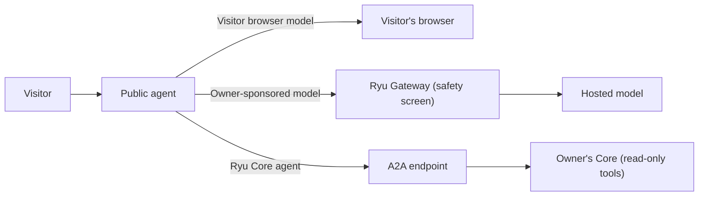

A public profile is a page at `https://ryuhq.com/u/<username>` that shows your bio, links, a
project showcase, and the activity sections you choose. You manage it from the
[browser app](/docs/surfaces/webapp) or Desktop. You can hide individual sections or make the whole
profile private.

## Profile contents

The profile shows the owner's display name, joined month, level, headline usage totals, and
privacy-safe verification signals.

A compact activity card shows a year of Ryu request activity in a Sunday-to-Saturday contribution
grid, with hover details for individual days. The card is built from Ryu usage data, not a linked
GitHub account. Days without a recorded request stay empty.

Usage totals include requests through a hosted Gateway, plus the daily totals that desktop devices
with a local Gateway send with their profile activity signal.

### Edit what is public

Open **Settings → Profile → Public profile** to add:

- a short bio;
- up to eight HTTPS links;
- up to twelve showcase items, each with an optional HTTPS cover image.

You can show or hide each section independently: activity, usage totals, model usage, plugin usage,
showcase, and public agents. Public profile reads include only the enabled sections.

Spend, points, session counts, email addresses, and private agent configuration are never part of
the public profile. A private profile is removed from the public route, including its activity and
annual Wrapped projection.

## Share a public profile

**Share profile** on a public profile opens a card with your name, handle, and joined month. If
usage totals are public, the card also shows your current streak, lifetime tokens, requests, agent
hours, and longest streak.

- Copy or download the card as an image, or save it as a video or GIF.
- Post the profile link to X or LinkedIn, or use **Copy link** to copy the profile URL.
- A shared profile link shows a preview image built from the same public sections. A private
  profile has no preview image with its details.

### Streaks

- **Current streak** is the number of consecutive UTC days with any Ryu activity on the account.
- **Longest streak** is the best run so far. It is kept when the current streak resets to zero
  after a whole UTC day with no activity.

A streak day is any UTC day on which you used Ryu. Agent runs count, including runs started by a
schedule, a workflow, or a channel, and Ryu Cloud managed agents. The built-in
[Patrol](/docs/surfaces/desktop/user-guide/agents#patrol-watches-your-setup) health and security
bot does not count, so a streak means you (or an agent working for you) used Ryu, not only that Ryu
was running.

The activity marker from Desktop adds nothing to token or request totals by itself. When the
device's Gateway does not report usage to Ryu Cloud, the same signal carries that device's daily
usage totals:

- They count toward your profile totals and heatmap.
- They never earn points. A day with only that activity earns no points, including no streak bonus.
- In your own Stats **Daily activity** heatmap, such a day shows at the lightest shade rather than
  empty.

See [Transparency](/docs/surfaces/desktop/transparency) to turn that signal off.

## Profile banner

Choose a Marketplace wallpaper in desktop **Settings → Profile → Profile banner** to add a shared
banner on the active node. Devices connected to that node share the choice, and its public profile
copy stays in sync so visitors can see it at `/u/<username>`. The selection is also added to this
device's Wallpaper Library. Clearing the selection removes the public banner.

If the public profile update fails after the node saves your banner, the node choice stays active
and **Retry public profile sync** retries the account copy. Pending saves stay with the account and
node where they started. Switching accounts or nodes does not publish that choice under the new
account or replace the new node's preview.

Your annual Wrapped card follows the same choices:

- If you hide **Usage stats**, the card leaves out token totals, agent hours, streaks, and XP.
- If you hide **Models**, it leaves out your top model.
- Your points balance is never shown on a public profile or Wrapped card.

## Publish an agent

Open **Settings → Profile → Public agents**. Create a draft, choose its runtime, then publish it.

A public agent appears only while all three are true:

1. The account profile is public.
2. The profile's **Agents** section is enabled.
3. The agent status is published. Paused and suspended agents are not listed.

Visitors do not need a Ryu account to open a public agent. The runtime decides where a turn runs:

| Runtime | Where turns run | Notes |
|---|---|---|
| **Visitor browser model** | Locally in the visitor's browser; turns stay in that browser | The owner explicitly consents to sharing the prompt, which is visible in the agent detail response |
| **Owner-sponsored model** | A low-cost hosted model through the Ryu Gateway, which screens each turn with Ryu's platform safety floor | Sends the current turn and bounded transcript context. The owner's monthly run cap counts admitted requests, not dollars |
| **Ryu Core agent** | The owner's Core node, through an HTTPS A2A endpoint and a principal bound to one published agent | Follows that node's task-retention policy. The server stores the bearer token encrypted and never returns it to visitors |

### Tools on a Core agent

Each Core-backed turn narrows the principal's tool grant to the intersection of:

- the profile's selected capabilities;
- the Core agent's own allowlist;
- tools marked read-only by Core.

Mutating tools stay off. An agent on Ryu's managed engine also runs without that engine's own shell
and file tools. Tool-enabled runs require a healthy Gateway-backed Core route.

<Callout type="warn">
Read-only does not mean public. An allowed tool can still return private files, account data, or
memory. Only grant sources intended for anonymous visitors.
</Callout>

## Budgets and abuse controls

Hosted and Core-backed agents have an owner-selected monthly request cap and a per-network rolling
rate limit.

- A request whose network address cannot be verified is refused rather than sharing one limit with
  other visitors.
- Successful admission is idempotent, so retrying the same turn does not start a second run.
- A failed upstream call still uses an admitted run.

These controls limit run volume. They do not set a currency budget. Gateway budgets and firewall
rules remain the spend and egress controls for Gateway-backed Core tools.

### Safety screening and reports

- **At publish time**, Ryu rejects selected high-confidence credential-theft, impersonation, and
  malware instructions.
- **On every reply** (visitor-local, hosted, and Core-backed), Ryu replaces the reply when
  high-confidence checks detect requests for passwords, verification codes, payment details,
  wallet keys, or recovery phrases.
- **Hosted refusals.** A hosted turn the Gateway's safety screen refuses returns a short refusal
  without the screen's reasons.
- **Reports.** Visitors can report spam, scams, impersonation, malware, unsafe content, or other
  issues. Reports accept a category only, not arbitrary prompt text.

This screening is not a guarantee that every harmful agent will be detected. Owners can pause an
agent at any time.

## Embed an agent

Select a published agent in **Settings → Profile → Public agents** and copy its iframe snippet. The
hosted embed uses `https://ryuhq.com/embed/agents/<username>/<slug>`. It runs without the
surrounding Ryu site navigation and keeps the frame sandboxed. Do not remove the sandbox attributes
when adapting the snippet.

The shareable profile URL is `/u/<username>`. Username subdomains such as `username.ryuhq.com` are
not enabled.

## Related guides

<Cards>
  <DocCard href="/docs/core/conversations-sessions" />
  <DocCard href="/docs/surfaces/desktop" />
  <DocCard href="/docs/surfaces/webapp" />
</Cards>
