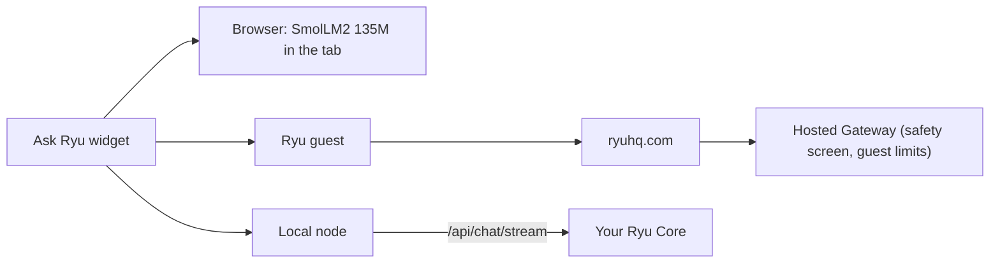

The public website is the part of [ryuhq.com](https://ryuhq.com) that works without a Ryu account.
For the signed-in workspace, see [Browser App](/docs/surfaces/webapp).

## Explore apps before setup

The public **Apps** page at `/apps` shows curated app previews before sign-in or connecting a
computer. These previews describe the apps and do not execute work.

- After approved sign-in, the page lists apps enabled on your node.
- When no node is connected, the previews stay available above the connection actions.
- Opening an actual app at `/apps/[id]` still requires approved access, node permissions, and any
  applicable paid services.

The public homepage also shows an illustrative sample workspace on desktop and mobile before
its download and setup actions. Sample content is not a generated result and uses no credits.

The interactive preview uses the same Bot-mode reading as the desktop app:

- **Agents** are the primary sidebar section. Each agent row shows its latest message, and its
  direct threads appear inline underneath.
- Group and fallback chats stay below the roster, without a separate Sessions tab.
- Switching use cases morphs the running preview into the selected workflow at its current phase.

## Landing page and navigation

The public landing page has **Download** and **Set up Ryu for me** actions. Its product previews
are samples. They do not show live account state or deploy a server.

- Compute and Share previews show early-access selection boundaries, not completed leases or
  published capacity.
- Blog, Changelog, and Help open directly into their filters, search, and entries.
- The [pricing page](https://ryuhq.com/pricing) has plan cards and a monthly or yearly billing
  selector.

The [Challenges page](https://ryuhq.com/challenges) lists published challenges, hackathons, and
events from the Ryu service. A signed-in member can register with their account, submit a project,
and review their own entry status. Administrators review submissions and can award Ryu Points from
the control plane; the browser does not invent participation, submissions, or awards locally.

On desktop, Products and Resources share one hover-activated surface. Challenges is grouped under
Resources, while Marketplace remains a direct top-level link.

### Phone navigation

On phone-sized public pages, the bottom navigation mirrors the desktop header:

| Position | Items |
|---|---|
| Left | **Products** and **Resources** |
| Center | A raised **Download** button |
| Right | **Marketplace** and **Account** |
| Top bar | The logo (goes home) and **Enterprise** |

- **Products** and **Resources** open focus-managed sheets. They close on Escape, the close button,
  the backdrop, or when you pick a destination.
- **Marketplace** and **Download** expose current-page state to assistive technology.
- Signed-out visitors see **Sign in** in the **Account** slot. Signed-in users see their avatar,
  which opens the menu for profile, invitations, settings, plan actions, theme, account switching,
  and sign-out.

In the signed-in workspace, account controls stay in the portal header beside the separate
organization switcher.

### Page loading

Public pages use app-style navigation. Links stay in the current browser session, route UI can be
prefetched before the click, and pages with live data show a loading shell while that data streams
in. Page content stays server-rendered.

This applies to the blog, help center, changelog, marketplace, and other content surfaces. Cached
route UI can be reused across visits, while request-specific data still loads for the destination.
Search, filters, sign-in, and downloads keep their existing behavior.

## Get the other Ryu apps

The signed-in account menu, on the website and in the browser app, has a **Get Ryu apps** submenu.
It links to the [download page](https://ryuhq.com/download) sections for the desktop app and the
browser extension. The mobile app is listed only when it can be installed from an app store.

## Help Center

The web Help Center groups published articles by category. Each category has its own page, so
reloading a category page keeps that selection.

- When the Help Center has enough articles (eight or more across at least two categories), a
  category strip appears above the list. Choose **All** in the strip to return to the full list.
- On a category page, the **Help Center** link above the heading also returns to the full list.
- An article shows a **Related** list of other articles from its category. Select a title to open
  that guide.

## Ask about a page

Help articles, guides, blog posts, and pages such as the privacy policy have the same two controls
under the title as these docs:

- **Copy Markdown** copies the page's [Markdown twin](/docs/extend/mcp/llms).
- **Open** lists **Open in Ryu**, Scira AI, ChatGPT, Claude, and Cursor, plus **View as Markdown**.
  Each assistant opens with a prompt asking it to read the page so you can ask questions about it.

**Open in Ryu** opens a new chat in the installed Ryu app through a `ryu://chat/new` link. The
prompt is placed in the composer for you to review; Ryu does not send it until you do. Without the
app installed, the link does nothing.

## Recover from an unexpected website error

If a website page shows **Something went wrong**, choose **Try again** to fetch
fresh page data and render the page again. A temporary data or rendering failure
can recover without navigating away from the page.

If the error affects the whole website shell, **Try again** reloads the document
so the shell and page can initialize again. If the error persists, return to the
page later or share the details with support.

## Enterprise page and theme

The public Enterprise page is available from the website header on desktop and mobile. It describes
organization identity, execution permissions, Gateway governance, and audit controls, with links to
their documentation.

**Talk to sales** opens an addressed email inquiry. It does not create an account or send an email
automatically.

The website theme control switches between light and dark appearance and remembers your selection.

## Ask Ryu on the public site

The public site and these docs include an **Ask Ryu** widget as a small, working example of a
visitor-facing AI surface. Choose its runtime from the settings button in the widget's header:

- **Browser** downloads the reviewed `SmolLM2 135M` ONNX artifact once, caches it in the
  browser, and runs the answer with Transformers.js using WebGPU or WASM. No account is required,
  and the question stays in the tab.
- **Ryu guest** sends the question, without page context, through the site to Ryu's hosted
  Gateway, which screens it for safety and applies guest limits. No API key is required, and the
  site picks the model.
- **Local node** connects directly to a running Ryu Core server after you provide its address and
  server token. The browser sends the question to that server's `/api/chat/stream` endpoint; the Ryu
  website does not proxy or store the token, and visitor turns use `persist: false`.

To use **Local node**, choose it in the widget and fill in the connection form in its composer, or
open the dedicated [`/connect` route](https://ryuhq.com/connect).

- Loopback addresses are the default. A LAN or remote address requires an explicit trust
  confirmation.
- Core must allow the site's origin through its CORS configuration.
- This is a browser bridge, not a silent account registration or a replacement for Core's server
  authentication.

The widget grounds public answers against a small, auditable documentation index and links to the
source page. It is separate from the authenticated browser app. A visitor can try the local model
without creating a cloud session, then choose a running server to use Ryu's configured agent and
Gateway policy.
