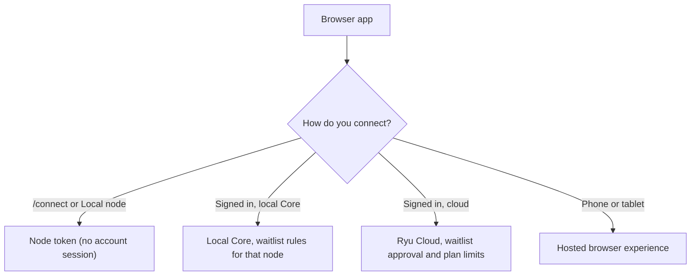

The browser app is Ryu in a web browser at [ryuhq.com](https://ryuhq.com). It is for people who
want Ryu without installing the desktop app, or who manage their account and organizations on the
web. It reuses the shared Desktop shell, so chats, agents, and Marketplace contributions look the
same, but it has no native windows, tray, file launchers, or app updater.

<Callout type="warn">
The hosted workspace requires a Ryu account that has cleared the waitlist for managed Ryu Cloud
access. There is no anonymous trial while waitlist access is active. Choose **Get Started** to sign
in.
</Callout>

## Sign in and get access

An approved account also needs a passkey or an authenticator app. Until it has one, the browser app
shows **Set up two-factor authentication**, which opens the website's setup page, with **Check
again**. The workspace opens once the factor is in place. See
[Required second factor](/docs/security/authentication-account#required-second-factor).

### Waitlist and invite passes

While you wait for access, enter a six-character code from Ryu or an early member on the waitlist
screen. When the code is accepted, the browser opens Ryu.

A member invite pass unlocks one account and expires at the weekly reset. The sender's invite pass
card changes to **Used** after the recipient redeems it. The Overview refreshes pass status while it
is open.

Invite links load their current status in your browser. A loading message appears while the
pass is checked; if the check is unavailable, refresh the page to retry. Checking a pass does
not redeem it.

### Connect to your own node

Direct `/connect` and the widget's **Local node** option authenticate to Core with that node's
own token, not a Ryu account session, so they stay separate from the signed-in waitlist gate.
Connecting to an existing node does not grant access to the hosted workspace.

## Choose where the work runs

- **Device path.** Direct `/connect` uses the node's own credentials. A signed-in client that opens
  a local Core follows the waitlist rules the Ryu account service sets for that node.
- **Cloud path.** Hosted access is subject to the account's waitlist approval and any plan or usage
  limits.
- **Phone or tablet.** Ryu continues with the hosted browser experience, because mobile browsers
  cannot install and manage a device runtime.

The browser never displays the session bearer. It stores the account session in its local auth vault
and uses it only for authenticated requests. Signing out removes the browser session.

The public **Apps** page at `/apps` shows app previews before you sign in. After approved sign-in it
lists the apps enabled on your node. See
[Explore apps before setup](/docs/surfaces/public-website#explore-apps-before-setup).

## What the browser app adds

The browser app owns browser navigation and browser-safe actions. It can prefer a reachable local
Core or continue with Ryu Cloud. It cannot load native modules or run the mobile `llama.rn` path.

| Capability | Browser behavior |
|---|---|
| Account access | Hosted managed access uses normal account sign-in followed by the server-authoritative waitlist gate and a required second factor |
| Local setup | Direct `/connect` uses the node's credentials; signed-in node access follows the server-selected waitlist scope |
| Cloud access | Use the hosted browser experience after approval |
| Browser actions | Use browser navigation, **Open in new tab**, reload, copy, fullscreen, and external links |
| Opened apps | Can call their own app routes, or another app's with its reviewed grant, when the node is bound to an organization you belong to; see [app requests in the web app](/docs/extend/develop/extensions/desktop-companion-capabilities#in-the-web-app) |
| Native boundaries | Hide Desktop windows, tray settings, native updater, local launchers, and OS-only controls |

Browser surfaces do not show Desktop-only actions such as **Open in new window**, launch-at-login
and tray settings, the native app updater, local editor or file-manager launchers, native
backup/restore controls, or the always-on-top media window. Right-click keeps the browser's normal
context menu instead of the Desktop app menu.

The Webapp, its phone-sized layout, and the browser extension dashboard align their top navigation
to the browser viewport. They do not reserve the macOS traffic-light gutter or the Windows/Linux
caption-button gutter used by Ryu's native Desktop window.

For browser-local model execution and in-page tools, use the [Browser extension](/docs/browser-extension).

## Signed-in workspace

### Header and overview

After sign-in, the Web app opens at the workspace overview with a two-row portal header.

- **First row.** Account controls come before the active organization, with a `/` separator and no
  separate Ryu mark. Inbox and Download sit on the right. Interaction sounds are in the account
  menu.
- **Second row.** The primary workspace routes: **Overview**, **Apps**, **Servers**, and
  **Marketplace**. In an organization view, this row shows the organization tabs with a
  **Console** back link.

The overview has a count row for servers, organizations, and teams. Below it are a getting-started
checklist, a desktop-app card, an Explore card, and plan actions. Certifications are available from
the Explore card and the public Academy navigation.

### Inbox

The signed-in **Inbox** sorts updates into **Invitations**, **Marketing**, and **Transactional**
categories.

- Open an item's action or invitation list link.
- Mark one item read, or mark all items in the current category read. Read state persists to the
  account.
- **Refresh inbox** reloads the selected view.

If the inbox is unavailable, the page shows an error. The caught-up message stays hidden until the
next successful read.

### Chat

In **Chat**, the first available agent is selected automatically. Choose another agent or clear the
selection. You cannot write a message while no agent is available.

| Control | What it does |
|---|---|
| **Enter** / **Shift+Enter** | Sends the message / adds a line |
| **Double-check** | Turns the extra review turn on or off |
| **Space** picker | Attaches a Space before you send. **Clear selection** leaves it unattached; **Retry loading spaces** fetches the list again after a failure |
| **Copy code** | Copies a code block. If the browser denies clipboard access, the message stays visible so you can retry; a successful copy clears the error |
| History row actions | Delete that conversation. Rows also work with keyboard selection |
| **Open sidebar** (phones) | Shows conversation history. Selecting a conversation or tapping the backdrop closes it |

### Settings

**Settings** on the web shows its sections as large tabs in the page header, under the account
bar:

- Profile, Stats, Account, Notifications, Connections, Referrals, Emails, Sessions & devices,
  OAuth apps, and Support access, plus links to the active organization's settings and billing.
- The tab you are on is highlighted. On a phone the row scrolls sideways and opens with the
  current tab in view.
- Each section has its own address, for example `/settings?tab=sessions`, so you can bookmark or
  share it.

## Notifications

The web app can show browser notifications when an agent replies, needs approval, or finishes a run.
The sending agent's avatar is the notification icon.

- **Turn them on.** Onboarding asks for permission from a button. **Settings → Privacy → Device
  permissions → Notifications** turns them on or off for this browser.
- **Service worker.** The web app installs a small service worker that only shows notifications and
  handles their clicks. It does not cache pages or intercept requests, so notifications keep
  working after you close the tab.
- **Phones.** Chrome on Android asks for permission directly. On iPhone and iPad, first add Ryu to
  the Home Screen (**Share → Add to Home Screen**) and open it from there.

For background alerts on a phone when Ryu isn't open, use the
[Ryu mobile app](/docs/mobile/native-surfaces).

## Interaction sounds

The browser app plays a quiet, synthesized sound cue for selected navigation, buttons, and toggles.
Cues are generated locally with the Web Audio API. No audio files are downloaded and no sound data
leaves the browser, and playback starts only after you interact with the page.

In the signed-in workspace, open the account menu and toggle **Interaction sounds**. The public-site
footer keeps its speaker button. The choice is kept in this browser on this device.

## Marketplace on the web

Marketplace search sits beside the toolbar, which wraps on narrow screens. Use the global search to
find listings across catalogs, or the search control inside a catalog to narrow that catalog alone.
If a federated catalog is temporarily unavailable, change or clear the search to try again.

**Open in Ryu** and bundle **Install** hand the selected destination to the installed Ryu app. The
browser does not complete a native installation or claim that a node install completed.

A paid listing opens Ryu's checkout page after sign-in, and a failed checkout request can be retried.
Returning without purchasing leaves the listing available to buy and does not create an owned
license.

The **Marketplaces** tab lists public publisher organizations. A signed-in visitor can choose
**Follow** on a publisher or on a listing's publisher row. The **Following** filter beside the search
field then works in every Marketplace tab. It is saved in the URL as `?following=1`, so you can
bookmark or share a filtered catalog.

## Related

<Cards>
  <DocCard href="/docs/surfaces/public-website" />
  <DocCard href="/docs/surfaces/public-profiles" />
</Cards>
