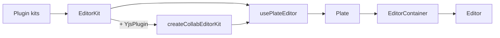

The shared [PlateJS](https://platejs.org) rich-text editor lives under `@ryu/ui/components/editor`. It exports the editor shell,
composition helpers, plugin kits, and the UI elements for editor nodes and toolbars.

## Mount an editor

Create the editor with `usePlateEditor` and the shared `EditorKit`, then render it inside the shared
container:

```tsx
import { EditorKit } from "@ryu/ui/components/editor/editor-kit";
import { Editor, EditorContainer } from "@ryu/ui/components/editor/ui/editor";
import { Plate, usePlateEditor } from "platejs/react";

export function DocumentEditor() {
  const editor = usePlateEditor({ plugins: EditorKit });

  return (
    <Plate editor={editor}>
      <EditorContainer>
        <Editor />
      </EditorContainer>
    </Plate>
  );
}
```

The pieces fit together like this:



`PlateEditor` from `@ryu/ui/components/editor/plate-editor` is a ready-made demo. It mounts
`EditorKit` with sample content, the `demo` editor variant, and the editor settings dialog. Use it
to preview the plugin set, not as a document editor.

<Callout type="warn">
An editor built from `createCollabEditorKit` must be created with `skipInitialization: true`.
Start and stop collaboration through `editor.getApi(YjsPlugin).yjs.init(...)` and `.destroy()`.
</Callout>

## Styles and theme accents

Editor selection and keyboard-focus accents use the shared `primary` theme token, so include the
shared theme stylesheet. For editor-specific plugin styling, load the editor stylesheet after it.
It defines
highlight styling and editor scroll-container utilities.

```css
@import "@ryu/ui/globals.css";
@import "@ryu/ui/components/editor/editor.css";
```

Highlight and comment styles are component defaults. Your own CSS rules (scoped to the editor
wrapper, or targeting comment attributes for the underline color) override them by normal CSS
precedence.

## Toolbar formatting values

| Control | Accepted value | Fallback |
|---|---|---|
| Font size | String mark | Current heading size, or the default 16-pixel size |
| Font color | String mark | A non-string mark is treated as unset |
| Alignment | `left`, `center`, `right`, `justify` | Any other value is ignored |

These fallbacks apply to toolbar inputs only. They do not validate or repair the editor document.

## Editor modules

| Area | Import | Use |
|---|---|---|
| Demo editor | `@ryu/ui/components/editor/plate-editor` | `PlateEditor` with sample content |
| Composer | `@ryu/ui/components/editor/composer-editor` | `ComposerEditor` for chat and prompt composition |
| Editor kit | `@ryu/ui/components/editor/editor-kit` | `EditorKit` (the shared plugin set) and `createCollabEditorKit` (adds Yjs collaboration) |
| Base kit | `@ryu/ui/components/editor/editor-base-kit` | `BaseEditorKit`, the base plugin set |
| Editor UI | `@ryu/ui/components/editor/ui/*` | Node renderers, toolbars, dialogs, and controls |
| Plugin kits | `@ryu/ui/components/editor/plugins/*` | Add focused editing capabilities |

Editor plugin kits are source modules. Compose only the capabilities a surface needs and keep the
host bridge or persistence adapter in the app that owns the document.

See also [Themes](/docs/ui/themes) and the [component catalog](/docs/ui/components).
