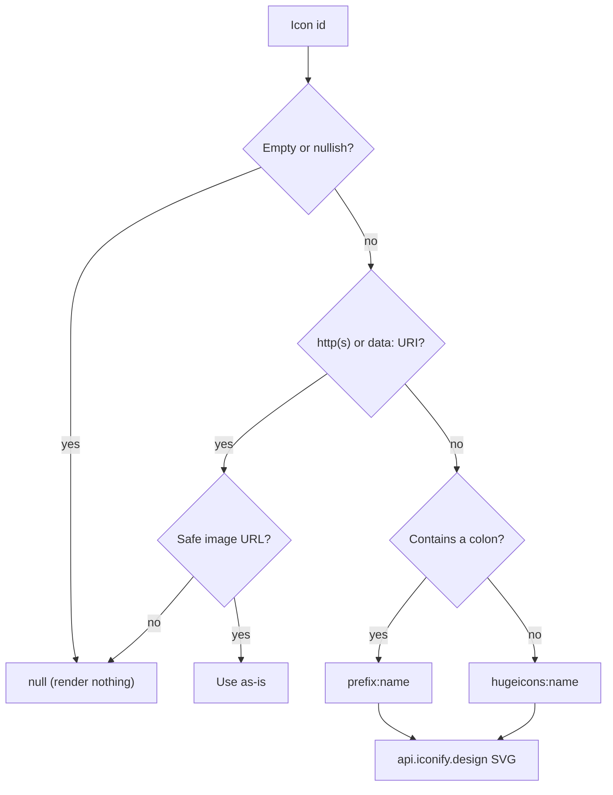

`Icon` (`packages/ui/src/components/icon.tsx`) renders a glyph from an **id** instead of a
hardcoded name-to-icon map. Apps register an icon id in their manifest, and the shell renders it
through this component. App and plugin tiles use the shared `AppIcon` presentation around that glyph.

```tsx
import { Icon, iconToUrl } from "@ryu/ui/components/icon";
```

## Icon id formats

One Iconify resolver accepts three id shapes. You can mix them.

| Id shape | Example | Resolves to |
|---|---|---|
| **Iconify / icons0.dev** `prefix:name` | `"lucide:heart"`, `"mdi:home"`, `"tabler:mic"` | That collection's glyph (150+ Iconify sets). icons0.dev redistributes the Iconify collections, so its ids resolve through the same host. |
| **Bare Hugeicons name** | `"ai-image"`, `"mic-01"`, `"shapes"` | Mapped to the `hugeicons:` set (`hugeicons:<name>`). This is how the built-in app manifests author their icons. |
| **Image URL or raster `data:image` URI** | `"https://…/logo.svg"`, `"data:image/png;base64,…"` | Returned unchanged with no lookup. A `data:` URI must be PNG, JPEG, GIF, WebP, or AVIF; anything else resolves to `null`. |

`iconToUrl` decides the shape in this order:



A `prefix` or `name` with characters other than letters, digits, `_`, and `-` also resolves to
`null`.

## Usage

```tsx
import { Icon } from "@ryu/ui/components/icon";

// Iconify / icons0.dev prefix:name
<Icon icon="lucide:heart" />

// Bare Hugeicons name → hugeicons:mic-01
<Icon icon="mic-01" />

// A ready URL or data: URI is used as-is
<Icon icon="https://example.com/logo.svg" />

// Size and an accessible label
<Icon icon="tabler:mic" size={24} label="Start recording" />
```

### Props

| Prop | Type | Default | Description |
|---|---|---|---|
| `icon` | `string \| null \| undefined` | none | The icon id (any of the three shapes above). A null or empty id renders nothing, so callers can fall back to a default glyph. |
| `size` | `number` | `16` | Rendered edge length in px. Drives both the box and the fetched SVG size. |
| `className` | `string` | none | Merged onto the rendered `<span>`. |
| `label` | `string` | none | Accessible label. When set, the span gets `role="img"` and `aria-label`. When omitted or `""`, the icon is `aria-hidden` (decorative). |
| `tone` | `"default" \| "muted"` | `"default"` | `"muted"` applies `text-muted-foreground`. |
| `motion` | `"opacity"` | none | Adds an opacity transition. |
| `visibility` | `"concealed" \| "row-hover"` | none | `"concealed"` hides the glyph. `"row-hover"` hides it while its `group/row` ancestor is hovered or focused. |
| `presentation` | `"panel-tab" \| "panel-launchpad"` | none | Shared glyph treatment for dock tabs and the launchpad. |

## Theme-aware by default

The glyph is painted with a CSS mask whose `background-color` is `currentColor`. It inherits the
surrounding text color and follows the light or dark theme, like the app's static Hugeicons
glyphs. Tint an `Icon` by setting text color on it or an ancestor. There is no color prop.

```tsx
// Follows the theme's foreground color
<span className="text-foreground">
  <Icon icon="lucide:heart" />
</span>

// Tinted red: the mask follows currentColor
<Icon icon="lucide:heart" className="text-red-500" />
```

<Callout type="info">
  Because it is a mask, a multi-color icon flattens to a single-color silhouette. Use monochrome and
  line sets such as Lucide, Tabler, Hugeicons, and MDI.
</Callout>

## Morphing stateful icons

Use `MorphIcon` when an icon changes because a control changed state. `MorphIconSwap` is the
short form for an A/B transition. It accepts Lucide-style icon data, Hugeicons data, or a raw
`d` path string. The wrapper honors `prefers-reduced-motion` by default (`reducedMotion="user"`)
and uses the `snappy` spring for swaps.

```tsx
import { Copy01Icon, Tick01Icon } from "@hugeicons/core-free-icons";
import { MorphIconSwap } from "@ryu/ui/components/morph-icon";

<MorphIconSwap
  a={Copy01Icon}
  b={Tick01Icon}
  className="size-4"
  state={copied ? "b" : "a"}
/>;
```

Keep static glyphs on the normal `Icon` or Hugeicons path. Use morphing for feedback that changes
meaning, for example copy to copied, loading to ready, or menu to close.

## `iconToUrl(icon, opts)`

`Icon` resolves the id through `iconToUrl`. Call it directly when you need the URL itself, for
example as an `` or a CSS `background-image` value.

```tsx
import { iconToUrl } from "@ryu/ui/components/icon";

iconToUrl("lucide:heart");
// → "https://api.iconify.design/lucide/heart.svg"

iconToUrl("mic-01", { size: 24 });
// → "https://api.iconify.design/hugeicons/mic-01.svg?width=24&height=24"

iconToUrl("lucide:heart", { color: "#ef4444" });
// → "…/lucide/heart.svg?color=%23ef4444"  (a fixed color baked into the SVG)

iconToUrl("");        // → null
iconToUrl(undefined); // → null
```

The `opts.color` param bakes a fixed color into the server-rendered SVG. It applies only when you
use the returned URL directly. The `Icon` component never passes it, because its mask already
inherits `currentColor`.

## How apps register an icon

An app's manifest declares its companion surface with an `icon` field. The value is any of the id
shapes above. The Desktop shell resolves it through this primitive, so there is no per-app glyph map.

```json title="manifest.json"
{
  "id": "com.example.recorder",
  "name": "Recorder",
  "version": "1.0.0",
  "companion": {
    "label": "Recorder",
    "icon": "mic-01",
    "shortcut": "ctrl+shift+r"
  }
}
```

The built-in app manifests use bare Hugeicons names (`"mic-01"`, `"ai-image"`, `"shapes"`). A
`prefix:name` id or a hosted URL works the same way. See
[Build a Desktop Companion](/docs/extend/develop/extensions/desktop-companion) for the full companion
surface.

<Callout type="warn">
  Resolution is **online**. `iconToUrl` points at `https://api.iconify.design`, so rendering a glyph
  by id fetches the SVG from that host. A surface that embeds `Icon` must allow the host in its CSP
  `img-src` (the Desktop shell and the whiteboard and canvas apps already do). URL and `data:` ids
  need no network round-trip.
</Callout>

## App and plugin icon design

Shipped apps and plugins use complete artwork rendered with Icon Composer's iOS 27 material
system. The source artwork uses large filled objects and separate layers: envelope folds,
calendar pages, overlapping windows, and other recognizable subjects. The enclosure, lighting,
shadows, and refraction come from the native renderer.

How the host displays that artwork:

- Light and dark images are bundled for offline rendering. End users do not need Xcode or Icon
  Composer installed.
- Dark appearances preserve the identifying colors of paper and book icons.
- Related apps have distinct artwork instead of reusing identical symbols.
- The host displays each completed image directly, without adding another glossy tile or drawing an
  outline glyph over it. Card and detail views use the same artwork.

### Authoring an icon

The `ryu-app-icon` agent skill covers object selection, layered SVG composition, native rendering,
and visual review. It pairs with the `ryu-creator` and `ryu-app-ui` skills. Design a few
representative icons and inspect them at actual catalog size before applying a style to a larger
collection.

Keep an editable `.icon` document with separate foreground layers. Let Icon Composer supply the
outer enclosure and material effects. Avoid baking double borders, inset plaques, or glossy
background effects into the foreground. Preserve third-party marks and their colors.

For your own app, publish a complete exported image and declare it as artwork:

```json title="manifest.json"
{
  "iconUrl": "https://example.com/my-app/icon.png",
  "iconPadding": "none"
}
```

Omit a competing top-level `icon` glyph when supplying the finished image. Installed custom
artwork uses the existing versioned icon cache. Unframed engine logos, theme palette swatches,
and custom backgrounds retain their existing display behavior.

A glyph-only manifest remains supported. Its `iconDither` field supplies a fallback color family
and can still drive a banner. A glyph fallback is not a substitute for designing layered artwork.

See [Apple's app icon guidance](https://developer.apple.com/design/human-interface-guidelines/app-icons)
and [Icon Composer](https://developer.apple.com/icon-composer/) for the visual references and native
workflow. Exported PNGs are flattened renders, and editable `.icon` documents retain the layers
for further design work. Tinted artwork uses the native TintedDark rendition.
