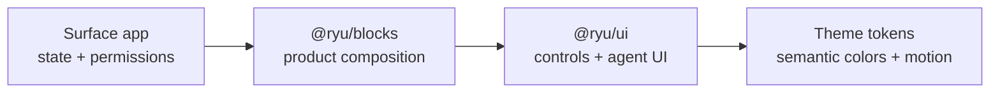

Ryu UI primitives give ordinary controls a common structure, interaction model, accessibility
baseline, and theme behavior. You choose the content and state. The primitive supplies the look.

## Choose the layer

Use the narrowest shared layer that owns the problem:

| Layer | Use it for | Ownership |
|---|---|---|
| `@ryu/ui/components/*` | Buttons, fields, menus, dialogs, data views, motion, and agent presentation | Ryu UI owns the component API and semantic styling |
| `@ryu/ui/theme/*` and `@ryu/ui/globals.css` | Tokens, presets, radius, typography, and reduced-motion behavior | Ryu UI owns the token names and theme contract |
| `@ryu/blocks/*` | Fixed product-role compositions such as companion shells and composer blocks | Blocks owns the composition; UI primitives remain the controls |
| Surface app code | Domain data, route state, provider calls, permissions, and product-specific layout | The app that owns the surface |

Some UI modules use focused behavior packages such as Base UI, React DayPicker, Embla, or Recharts.
Those dependencies provide implementation behavior. The import path, component contract, and
semantic token usage remain Ryu-owned through `@ryu/ui`.

The layers stack like this:



## Start with the primitive

For an ordinary surface, load `@ryu/ui/globals.css` once, import the shared primitive from its own
subpath, then pass content and state. [Getting Started](/docs/ui/getting-started#use-a-component)
shows the setup and a first component.

Every catalog page includes a live preview with representative props. Use the [component
catalog](/docs/ui/components) to inspect the available modules and their named exports.

<SurfacePreview surface="chat" />

## Progressive squircle corners

The shared `globals.css` and Companion `app-ui.css` styles register the
[`@toolwind/corner-shape` plugin](https://github.com/toolwind/corner-shape).

- Shared rectangular primitives (buttons, fields, cards, menus, dialogs, sheets, and drawers) apply
  `corner-squircle` alongside their `rounded-*` utilities.
- The `rounded-*` radius stays as a fallback in browsers that do not support the native CSS
  `corner-shape` property.
- Circular controls, avatars, and pill surfaces (`rounded-full`) keep ordinary round corners.

The desktop window shell and its portaled overlays use the same configurable window radius with
squircle shaping. The Island applies it to its morphing detail surface while retaining a circular
logo and round action pills.

## Use semantic tokens

Use semantic utilities instead of hard-coded surface colors. The shared stylesheet maps these names
to the active light or dark theme:

| Token utility | Use |
|---|---|
| `bg-background` and `text-foreground` | Page or primary surface content |
| `bg-card` and `text-card-foreground` | Raised content surface |
| `bg-muted` and `text-muted-foreground` | Secondary surface and supporting text |
| `bg-primary` and `text-primary-foreground` | Primary action or selected state |
| `border-border` and `ring-ring` | Boundaries and focus indication |
| `text-destructive`, `text-success`, `text-warning`, `text-info` | Status meaning |

Use `cn()` when a surface adds conditional classes or accepts a caller override:

```tsx
import { cn } from "@ryu/ui/lib/utils";

<div className={cn("rounded-2xl corner-squircle bg-card p-4", isActive && "ring-2 ring-ring", className)} />;
```

The [theme reference](/docs/ui/themes) documents presets, custom tokens, typography, radius, and
reduced-motion behavior.

## Compose named parts

Compound primitives export their related parts from the same module. Use those parts when you need
structure. This keeps labels, focus behavior, overlay positioning, and spacing aligned:

```tsx
import {
  Dialog,
  DialogContent,
  DialogDescription,
  DialogHeader,
  DialogTitle,
  DialogTrigger,
} from "@ryu/ui/components/dialog";

export function SettingsDialog() {
  return (
    <Dialog>
      <DialogTrigger>Open settings</DialogTrigger>
      <DialogContent>
        <DialogHeader>
          <DialogTitle>Settings</DialogTitle>
          <DialogDescription>Change the settings for this surface.</DialogDescription>
        </DialogHeader>
      </DialogContent>
    </Dialog>
  );
}
```

The same pattern applies to `Card`, `Accordion`, `Tabs`, `Select`, `Popover`, menus, `Field`,
`Table`, and the agent UI modules. The generated page shows the complete named export list for each
module.

## Keep state and permissions outside the primitive

Use uncontrolled defaults for a local interaction. Use controlled props when route state, server
state, or another component owns the value:

```tsx
import { useState } from "react";
import { Tabs, TabsContent, TabsList, TabsTrigger } from "@ryu/ui/components/tabs";

export function SettingsTabs() {
  const [tab, setTab] = useState("general");

  return (
    <Tabs onValueChange={setTab} value={tab}>
      <TabsList>
        <TabsTrigger value="general">General</TabsTrigger>
        <TabsTrigger value="access">Access</TabsTrigger>
      </TabsList>
      <TabsContent value="general">General settings</TabsContent>
      <TabsContent value="access">Access settings</TabsContent>
    </Tabs>
  );
}
```

`TabsList` adds a sliding active indicator for every variant except `text` and `stepper`, which
keep their label and step treatments:

- Selection changes use a 250ms transition with `cubic-bezier(0.22, 1, 0.36, 1)` easing
  (`--tabs-dur` and `--tabs-ease`).
- The indicator snaps into place on first paint and layout changes. Reduced-motion preferences
  disable the slide.
- To customize the marker, place one `TabsIndicator` inside the list. It replaces the automatic
  indicator. Keyboard navigation and selection remain owned by the tabs primitive.

The primitive does not decide whether a user may perform an action. Keep authorization, credential
handling, provider calls, and persistence in the owning app or server route. Disable or hide a
control only after that owner has resolved the allowed state.

## Component sections and ownership

The sidebar groups the catalog by the kind of interface it provides:

| Sidebar section | Contents |
|---|---|
| Core primitives | Small controls such as `Button`, `Badge`, `Input`, `Checkbox`, and `Progress` |
| Layout and navigation | Cards, tabs, breadcrumbs, sidebars, pagination, and resizable panels |
| Overlays and dialogs | Dialogs, drawers, sheets, popovers, menus, tooltips, and command surfaces |
| Forms and data | Fields, selects, calendars, tables, color pickers, toggles, and OTP input |
| Chat and communication | Messages, bubbles, attachments, avatars, and emoji input |
| Visualization | Charts, profile charts, and contribution graphs |
| Motion and effects | Reduced-motion-safe transitions, number effects, loaders, and waves |
| Ryu-specific components | Product badges, dither visuals, lanyards, signatures, and download controls |
| Agent UI | Activity, approvals, citations, code, diffs, todo lists, and tool results |

These are navigation and usage sections, not separate packages. All pages in this catalog are
exported by `@ryu/ui`. A module can use a third-party behavior engine and still be a Ryu UI
component because Ryu owns the public export and its semantic styling.

## Accessibility and motion

Prefer the semantic component over a styled generic element. The shared controls provide the
appropriate roles, keyboard behavior, focus treatment, and state attributes for their interaction.
Give icon-only controls an accessible label and give fields a visible label or an explicit
`aria-label`.

Shared animations read `prefers-reduced-motion: reduce`. Keep that behavior when composing a
primitive. For a custom transition, provide a reduced-motion path that removes decorative movement
without hiding the content or its state.

## Glyph footprints and caller styles

`GlyphDisplay` and the glyph picker previews use `size` for a square footprint. Supply a finite,
nonnegative pixel size. Expressive colors must be valid CSS colors, and icon colors use the shared
icon palette. An omitted icon or expressive foreground color inherits the caller's text color.

Prefer the `size` and color props. Glyph footprints and foreground colors follow ordinary
component CSS rules:

- A more specific unlayered caller rule can override them, and an `!important` caller rule still
  wins.
- Tailwind utilities in the utilities layer do not replace an unlayered component rule just
  because they appear later in `className`.
- Invalid lengths or colors follow the browser's CSS fallback.

## Book drawings and caller styles

`BookCard`, exported from `@ryu/ui/components/book-card.tsx`, draws a collection item's binding,
paper edges, and cover shading with themed component stylesheet rules. Its `className` applies
to the outer wrapper.

Drawing defaults follow the ordinary CSS cascade. A stronger caller rule can override the outer
wrapper's perspective. A rule targeting the book container can override its aspect ratio and
change the height and page layout.

Pass `width` as a pixel number. The cover width, container minimum width, and page dimensions are
derived from that prop. Take care when overriding drawing styles, because the book's geometry
depends on these dimensions. Keep opening actions, keyboard behavior, and nested controls in the
surrounding shelf or card; `BookCard` supplies the drawing.

## Related

<Cards>
  <DocCard href="/docs/ui/getting-started" />
  <DocCard href="/docs/ui/components" />
  <DocCard href="/docs/ui/themes" />
  <DocCard href="/docs/ui/hooks" />
</Cards>
