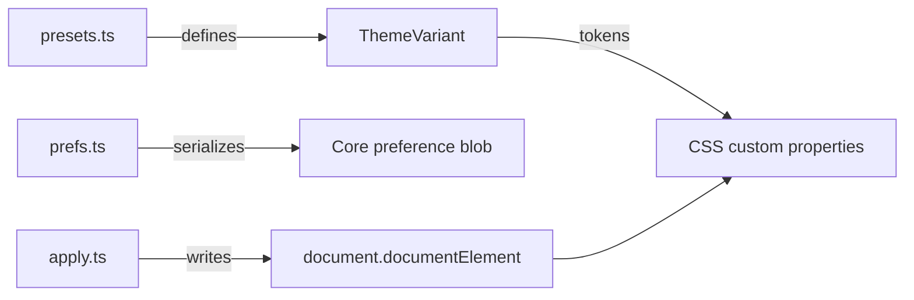
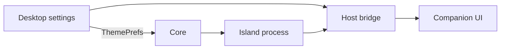

The theme system applies CSS custom properties to the document root. Components consume semantic
tokens, so a surface can change its visual treatment without changing component code.

## Modules

| Module | Import | Responsibility |
|---|---|---|
| Presets | `@ryu/ui/theme/presets` | Theme variants and token maps |
| Apply | `@ryu/ui/theme/apply` | Write tokens, contrast, radius, and fonts to the DOM |
| Preferences | `@ryu/ui/theme/prefs` | Persist mode, preset, typography, and custom theme preferences |

`presets.ts` is pure data with no DOM access. `apply.ts` writes to `document.documentElement`.
`prefs.ts` normalizes the `ThemePrefs` blob that Desktop exchanges through Core.



## Preset IDs

The Web and Desktop surfaces share 88 built-in presets (`THEME_VARIANTS` in
`packages/ui/src/theme/presets.ts`). Use the exact IDs below when storing a preference.

| Family | Light | Dark |
|---|---|---|
| **Ryu** (default) | `ryu-light`, `ryu-light-mono` | `ryu-dark`, `ryu-dark-mono` |
| **Codex** | `codex-light` | `codex-dark` |
| **Claude** | `claude-light` | `claude-dark` |
| **Ayu** | `ayu-light` | `ayu-dark` |
| **Catppuccin** | `catppuccin-light` | `catppuccin-dark` |
| **Dracula** | `dracula-light` | `dracula-dark` |
| **GitHub** | `github-light` | `github-dark` |
| **Linear** | `linear-light` | `linear-dark` |
| **Nord** | `nord-light` | `nord-dark` |
| **Notion** | `notion-light` | `notion-dark` |
| **One** | `one-light` | `one-dark` |
| **Raycast** | `raycast-light` | `raycast-dark` |
| **Tokyo Night** | `tokyo-light` | `tokyo-dark` |
| **Gruvbox** | `gruvbox-light` | `gruvbox-dark` |
| **Solarized** | `solarized-light` | `solarized-dark` |
| **Rosé Pine** | `rose-pine-dawn` | `rose-pine`, `rose-pine-moon` |
| **Everforest** | `everforest-light` | `everforest-dark` |
| **Kanagawa** | `kanagawa-lotus` | `kanagawa-wave`, `kanagawa-dragon` |
| **Night Owl** | `night-owl-light` | `night-owl` |
| **Material** | `material-theme-lighter` | `material-theme`, `material-theme-darker`, `material-theme-ocean`, `material-theme-palenight` |
| **Min** | `min-light` | `min-dark` |
| **Slack** | `slack-ochin` | `slack-dark` |
| **Snazzy** | `snazzy-light` | none |
| **Vitesse** | `vitesse-light` | `vitesse-dark`, `vitesse-black` |
| **Light Plus / Dark Plus** | `light-plus` | `dark-plus` |
| **Horizon** | `horizon-bright` | `horizon` |
| **Vercel** | `vercel-light` | `vercel-dark` |
| **Dark only** | none | `monokai`, `synthwave-84`, `poimandres`, `one-dark-pro`, `laserwave`, `houston`, `plastic`, `red`, `andromeeda`, `amoled-dark` |

The base color families Slate, Stone, Gray, Red, Rose, Orange, Green, Blue, and Violet each ship a
light and a dark preset, from `slate-light` and `slate-dark` through `violet-light` and
`violet-dark`.

Each preset is a `ThemeVariant` object with this shape.

```typescript
interface ThemeVariant {
  appearance?: ThemeAppearance; // optional density, font, and size overrides
  id: string;                   // for example "ryu-dark"
  label: string;                // for example "Ryu Dark"
  mode: "light" | "dark";
  preview: { bg: string; surface: string; primary: string; text: string }; // picker swatch
  tokens: Record<string, string>; // CSS custom property overrides
}
```

## Apply a theme

```tsx
import { applyVariant, applyRadius, applyFonts } from "@ryu/ui/theme/apply";
import { findVariantIn } from "@ryu/ui/theme/presets";

const theme = findVariantIn("ryu-dark");
if (theme) applyVariant(theme);
applyRadius(0.625);
applyFonts("Inter", "Geist", "JetBrains Mono");
```

`applyVariant(variant, contrast)` also re-applies the contrast curve; `contrast` defaults to
`DEFAULT_CONTRAST` (50). `applyContrastToMuted(value)` takes a value from 0 to 100. At 50 the muted
tokens keep the preset values. Above 50 it mixes `--muted` and `--muted-foreground` toward white,
and below 50 toward black, by up to 25% with `color-mix`.

### Numeric and code typography

| Text | Utility or token | Face |
|---|---|---|
| Numeric values such as line counts, prices, balances, and currency amounts | `font-mono` | Bundled Geist Mono, so digits stay aligned without changing the heading face |
| Code blocks | `font-code` | The user's code-font preference |
| Interface labels, headings, status text, and descriptions | Sans or heading face | The user's UI and heading fonts |

Do not use a generic system mono for decorative interface copy.

## Persisted preferences

`@ryu/ui/theme/prefs` defines the `ThemePrefs` shape:

```typescript
interface ThemePrefs {
  version: number;
  mode: "light" | "dark" | "system";
  lightPreset: string;   // ThemeVariant id
  darkPreset: string;    // ThemeVariant id
  contrast: number;      // 0-100
  radius: number;        // rem
  spacing?: number;      // rem, shared Tailwind base unit
  scale?: number;        // whole-surface UI zoom
  cardSpacing?: number | null; // rem, or null to derive from spacing
  pointerCursor?: boolean;
  chromeShadows?: boolean;
  dialogOverlayBlur?: boolean;
  popupOverlayBlur?: boolean;
  invertedBackgrounds?: boolean;
  animationsEnabled?: boolean;
  timezone?: string;     // effective IANA display zone
  locale?: string;       // effective BCP-47 display locale
  customThemes: ThemeVariant[];
  uiFont?: string;
  headingFont?: string;
  codeFont?: string;
}
```

Optional fields fall back to defaults in `normalizeThemePrefs`.

Desktop publishes this blob to Core, so the separate Island process and its hosted apps resolve the
same custom palette, appearance values, display timezone, and locale. A Companion UI receives the
same values through the host bridge.



See [Companion UI](/docs/extend/develop/extensions/companion-ui) for the theme subscription and
timestamp helpers.

## Custom themes

Convert a preset to editable tokens, change the values, and turn it back into a `ThemeVariant`
with these helpers.

```tsx
import {
  customTokensToVariant,
  variantToCustomTokens,
} from "@ryu/ui/theme/presets";

const tokens = variantToCustomTokens(myVariant);
tokens.primary = "oklch(0.5 0.2 250)";

const custom = customTokensToVariant("my-theme", "My Theme", "dark", tokens);
```

Leave `ring` unset and the focus ring follows `primary`. If that color is under 3:1 against the
background, card, popover, or sidebar, `customTokensToVariant` keeps its hue and shifts its
lightness just enough to reach 3:1 (WCAG 1.4.11). Set `tokens.ring` to choose the ring yourself.

When `normalizeThemePrefs` reads stored preferences, each custom theme must match the complete
`ThemeVariant` schema:

- If any entry is invalid, the whole collection falls back to no custom themes.
- Accepted entries keep their order, and the function returns parsed copies.
- An empty custom-theme collection does not reset theme tokens that were already applied.

For the Desktop settings that use these preferences, see
[Layout, text, and motion](/docs/surfaces/desktop/user-guide/appearance#layout-text-and-motion).

## Status labels and fills

| Use | Classes |
|---|---|
| Status fills and indicators | `bg-success`, `bg-warning`, `bg-info`, `bg-destructive` |
| Small status text | `text-status-success`, `text-status-warning`, `text-status-info`, `text-status-destructive` |

The `text-status-*` roles mix the active status color with the foreground, so the text stays
readable in light, dark, and custom themes.

- Companion UI stylesheets can use the matching `--status-*` CSS variables.
- Hosts that supply their own tokens and stylesheet can import the lightweight
  `@ryu/ui/status-colors.css` for the same text roles.

Use the ordinary foreground and muted-foreground tokens for neutral copy. Keep drawing, chart
category, syntax, and brand palettes separate from control and status styling.

## Full-page Companion UIs

A full-page Companion UI runs in a sandboxed document. The host supplies the resolved semantic
tokens on first paint and updates them when the active theme changes. Use the canonical token names
in the app CSS:

```css
body {
  background: var(--background);
  color: var(--foreground);
}
```

Do not use `Canvas`, `CanvasText`, fixed light or dark palettes, or app-local aliases for page
surfaces and controls. Keep the interaction semantics (`button`, `a`, `label`, and visible
`:focus-visible` states), and use the shared components for ordinary controls when the bundle
allows it.

## Native palette

Native components use the HeroUI Native palette through UniWind. These roles follow the native
light or dark theme:

| Use | Classes |
|---|---|
| Surfaces | `bg-surface`, `bg-surface-secondary`, `bg-surface-tertiary` |
| Neutral controls | `bg-default` |
| Inputs | `bg-field` |
| Accent backgrounds | `bg-accent` |

Desktop class names such as `bg-secondary`, `bg-primary`, and `bg-card` are not native palette
aliases.

## Server-generated images

Ryu's patched Next.js `ImageResponse` accepts the Satori `tailwindConfig` option for its
experimental `tw` prop in Node and Edge image rendering (`patches/next@16.4.1.patch`).

- Supply resolved colors and fonts in that configuration. Server-rendered images do not load
  browser stylesheets or resolve the app's CSS theme tokens.
- Inline `style` values still override styles generated by `tw`.
- Satori initializes its Tailwind engine once per rendering runtime, so use one consistent
  `tailwindConfig` for that runtime.

## Reduced motion

All shared animations respect `prefers-reduced-motion: reduce`. When the OS setting is on,
`globals.css` collapses animation and transition durations to 0.01ms, so `animationend` and
`transitionend` events still fire. Some named components instead switch to a static resting state.

Keep that behavior when adding surface-specific transitions. See [Accessibility and motion](/docs/ui/primitives#accessibility-and-motion).
